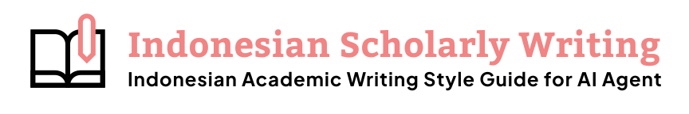

<p align="center">
  
</p>

# Indonesian Academic Writing

Skill penulisan akademik berbahasa Indonesia untuk agen AI. Membantu menyusun, menyunting, dan menelaah makalah, laporan, proposal, tugas akhir, skripsi, tesis, disertasi, serta artikel ilmiah dengan bahasa yang jelas dan klaim yang dapat ditelusuri.

**Pedoman dan templat perguruan tinggi pengguna menentukan format dokumen.** Kerangka dalam skill ini bersifat umum: tidak mewajibkan lima bab, jenis huruf, margin, jumlah kata, jumlah pertanyaan penelitian, atau gaya sitasi tertentu.

## Instalasi

Paket menggunakan format [Agent Skills](https://agentskills.io/specification). CLI [skills](https://github.com/vercel-labs/skills) mendukung pemasangan ke beberapa agen, termasuk Codex, Claude Code, OpenCode, dan Cursor. Kemampuan membaca dokumen, menelusuri web, dan mengekspor berkas mengikuti fasilitas agen yang digunakan.

Setelah repositori GitHub dipublikasikan:

```bash
npx skills add azkadani214/indonesian-academic-writing --skill indonesian-academic-writing
```

Pilih agen melalui menu instalasi. Untuk memilih agen secara langsung:

```bash
npx skills add azkadani214/indonesian-academic-writing --skill indonesian-academic-writing -a codex
```

Untuk mencoba salinan lokal, jalankan dari direktori repositori ini:

```bash
npx skills add . --list
npx skills add . --skill indonesian-academic-writing
```

Tambahkan `-g` bila ingin memasang pada lingkup pengguna. Gunakan `--copy` bila lingkungan tidak mendukung tautan simbolis. Instalasi CLI membutuhkan Node.js; periksa persyaratan versi pada [dokumentasi CLI](https://github.com/vercel-labs/skills/blob/main/README.md).

## Penggunaan

Sebutkan nama skill dalam permintaan. Sintaks pemanggilan khusus mengikuti agen; paket ini tidak mendaftarkan kumpulan slash command tersendiri.

> Gunakan indonesian-academic-writing untuk menyunting latar belakang ini. Pertahankan angka, makna, dan sitasi. Ikuti templat kampus yang saya lampirkan.

> Bantu menyusun kerangka proposal dari topik dan sumber ini. Petakan bagian-bagiannya ke pedoman program studi; tandai informasi yang belum tersedia.

> Tinjau keselarasan rumusan masalah, tujuan, metode, hasil, dan simpulan skripsi saya. Pisahkan temuan tentang bahasa dari temuan tentang substansi dan sumber.

> Periksa sitasi dan daftar pustaka sesuai gaya yang ditentukan jurnal. Laporkan metadata dan isi sumber yang belum berhasil diverifikasi.

Jika belum ada templat, agen dapat menggunakan kerangka sementara dengan asumsi yang dinyatakan. Data dan hasil yang belum tersedia tidak akan diisi dengan temuan rekaan.

## Isi paket

```text
skills/indonesian-academic-writing/
├── SKILL.md
├── LICENSE
├── references/
│   ├── language/       # Bahasa, ejaan, dan gaya akademik
│   ├── documents/      # Jenis dokumen dan adaptasi templat
│   ├── research/       # Perencanaan sampai simpulan
│   ├── citations/      # Verifikasi sumber dan integritas
│   ├── technical/      # Angka, persamaan, tabel, dan gambar
│   ├── quality/        # Audit dan contoh penyuntingan
│   ├── prompts/        # Contoh permintaan per tahap
│   └── sources/        # Asal bahan dan pemetaan 29 gambar
└── assets/
    └── institution-profile.md
```

Mulai dari [instruksi utama](skills/indonesian-academic-writing/SKILL.md). Agen hanya perlu membaca referensi yang sesuai dengan tugas. [Profil pedoman institusi](skills/indonesian-academic-writing/assets/institution-profile.md) membantu mencatat ketentuan pengguna; berkas ini bukan templat naskah wajib.

## Prinsip isi

- Bahasa Indonesia formal, lugas, dan konsisten; istilah teknis tetap akurat.
- Penyuntingan mempertahankan data, besaran, kutipan, dan batas kesimpulan.
- Kerangka dapat berubah mengikuti disiplin, desain penelitian, jenis dokumen, dan institusi.
- Sumber nyata, hasil penelusuran, dugaan, dan contoh ilustratif dibedakan dengan jelas.
- Penggunaan AI mengikuti ketentuan institusi atau penerbit; tidak menjanjikan kelolosan detektor atau penilaian akademik.

Skill disusun dari bahan teks dan 29 tangkapan layar yang diberikan pengguna, lalu disunting dan digeneralisasi. [Peta bahan sumber](skills/indonesian-academic-writing/references/sources/materials-map.md) mencatat cakupan, penggabungan materi berulang, serta koreksi terhadap saran yang tidak berlaku umum. Gambar sumber tidak disalin ke paket instalasi; diagram konseptual di referensi dibuat ulang sebagai rangkuman.

## Pemeriksaan dan publikasi

```bash
python scripts/validate_package.py
```

Pemeriksaan ini mencakup struktur paket, metadata, tautan berkas lokal, dan portabilitas. Pemeriksaan tersebut tidak membuktikan kualitas keluaran setiap agen. Skenario penilaian perilaku tersedia di [tests/scenarios.md](tests/scenarios.md).

Versi awal **0.1.0** memuat **17 modul referensi** dalam bahasa Indonesia. Hasil uji dan batasnya dicatat di [docs/VALIDATION.md](docs/VALIDATION.md).

Panduan rilis ada di [docs/PUBLISHING.md](docs/PUBLISHING.md). Menurut [FAQ skills.sh](https://skills.sh/docs/faq), skill disimpan di GitHub dan dapat muncul di direktori melalui telemetri instalasi. Menyiapkan paket lokal belum berarti repositori telah dipublikasikan atau terindeks.

## Lisensi dan atribusi

Instruksi, contoh, dan skrip baru dalam proyek ini menggunakan [MIT License](LICENSE). Logo diberikan pengguna untuk README. Lisensi proyek tidak mengalihkan hak atas logo, gambar sumber, dokumen pihak ketiga, atau materi yang dirujuk. Logo bukan bagian dari instruksi skill yang dipasang ke agen.
