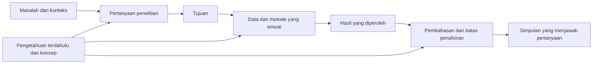

# Perencanaan dan Keselarasan Penelitian

## Masukan minimum

Gunakan topik, bidang, tujuan tugas, bahan awal, dan batas akses data. Jika baru ada judul, bantu menguraikan kemungkinan fokus; jangan menyimpulkan bahwa judul sudah membuktikan masalah, kebaruan, atau kelayakan metode.

## Dari topik menjadi masalah

Bedakan topik luas, fenomena yang dapat didokumentasikan, dan persoalan yang perlu dijawab. “Pembelajaran daring” adalah topik; kesulitan tertentu dalam suatu konteks dapat menjadi fenomena; hubungan, proses, makna, atau masalah rancangan yang belum dijelaskan dapat menjadi persoalan penelitian.

Latar belakang sebaiknya menghubungkan konteks khusus, bukti masalah, pengetahuan yang sudah tersedia, keterbatasan pengetahuan tersebut, serta alasan penelitian dilakukan. Tidak semua penelitian harus dimulai dari pertentangan antara kondisi ideal dan kenyataan. Studi replikasi, eksplorasi, kajian konsep, dan perancangan dapat memiliki alasan yang berbeda.

Ketika sumber belum tersedia, buat daftar bukti yang dibutuhkan. Jangan mengarang statistik, pandangan ahli, kasus lapangan, atau pertentangan antarpenelitian untuk membangun latar belakang.

## Pertanyaan, tujuan, dan manfaat

Pertanyaan penelitian harus dapat dijawab dengan data atau bahan yang mungkin diperoleh. Sesuaikan jumlah pertanyaan dengan cakupan, bukan aturan minimal tiga pertanyaan. Urutan umum ke khusus dapat membantu, tetapi pertanyaan tidak harus memiliki bentuk yang sama.

Rumusan masalah dapat berbentuk pertanyaan atau pernyataan sesuai pedoman. Tidak wajib diawali “terdapat”. Tujuan mengungkapkan pekerjaan pengetahuan yang akan dilakukan, misalnya mendeskripsikan proses, menganalisis hubungan, menafsirkan konsep, atau mengevaluasi kinerja. Kata “mengetahui” dapat dipertajam bila objek dan hasil yang diharapkan masih kabur.

Manfaat menjelaskan pihak yang mungkin menggunakan hasil dan untuk keperluan apa. Pada proposal, manfaat merupakan harapan yang beralasan. Pada laporan akhir, bedakan implikasi yang didukung hasil dengan manfaat yang belum diuji. Jangan menjanjikan dampak pada seluruh masyarakat jika penelitian hanya mendukung konteks yang terbatas.

## Matriks keselarasan

Gunakan satu baris untuk setiap pertanyaan atau tujuan yang perlu dilacak.

| Masalah/pertanyaan | Tujuan | Data atau bahan | Cara memperoleh dan menganalisis | Hasil yang diperlukan | Batas simpulan |
| --- | --- | --- | --- | --- | --- |
| [pertanyaan] | [tujuan sepadan] | [sumber/variabel/korpus] | [prosedur] | [bentuk jawaban, bukan hasil rekaan] | [cakupan yang dapat dijawab] |

Contoh hipotetis: pertanyaan “Bagaimana mahasiswa menggunakan umpan balik tertulis?” dapat diarahkan pada uraian proses berdasarkan dokumen revisi dan wawancara yang direncanakan. Pertanyaan ini tidak otomatis menuntut uji pengaruh terhadap nilai. Sebaliknya, pertanyaan tentang pengaruh memerlukan dasar desain dan analisis yang sesuai; pilihan kata dalam judul tidak menciptakan bukti kausal.

## Kerangka berpikir

Tunjukkan hubungan antara konsep, masalah, bukti yang dicari, serta alasan prosedur yang dipilih. Jelaskan istilah kunci yang berperan dalam hubungan itu. Definisi operasional diperlukan ketika konsep diterjemahkan menjadi indikator atau tindakan pengamatan; jangan menganggap setiap istilah harus menjadi variabel terukur.

Kerangka berpikir dapat berupa narasi, diagram, atau keduanya. Anak panah harus diberi makna: urutan kerja, dugaan hubungan, atau dasar penafsiran. Jangan memakai panah kausal untuk hubungan yang hanya bersifat konseptual. Hipotesis digunakan jika sesuai desain dan pedoman, bukan untuk semua studi kualitatif atau konseptual.

Diagram ini menunjukkan keselarasan kerja, bukan model hubungan sebab-akibat antarvariabel.

## Urutan kerja dan urutan naskah

Penulis dapat mulai dari pemetaan sumber, pertanyaan sementara, atau data awal yang sah. Rumuskan rancangan, kumpulkan dan analisis data sesuai prosedur, lalu revisi argumen agar sesuai temuan. Abstrak biasanya lebih mudah diselesaikan setelah isi utama stabil. Urutan kerja tidak harus sama dengan urutan bab.

Perubahan pertanyaan setelah melihat data perlu dicatat secara jujur. Bedakan analisis yang direncanakan dari eksplorasi tambahan, terutama jika ada protokol atau praregistrasi. Jangan mengubah tujuan diam-diam agar semua hasil tampak sesuai dugaan awal.
